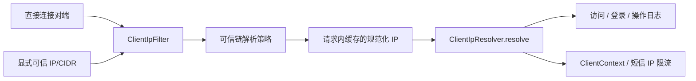

# Design

## Context

需求和现状见 interview.md、explore.md。当前 XFF 首项可控，其结果同时进入访问/登录/操作日志和短信限流。目标是在所有消费者之前统一建立可信来源边界，保持调用签名和业务限额不变。默认不信任代理，不推断私网或 Compose 网段。

## 宪法对照

| 原则 | 判定 | 说明 |
|---|---|---|
| CP-1 领域层不依赖框架 | ☑ 符合 | Servlet 解析仅放 framework 的 Spring Web 基础设施，领域上下文仍是字符串 |
| CP-2 依赖方向单向向内 | ☑ 符合 | 适配层继续通过共用入口组装 ClientContext，不反向依赖 |
| CP-3 持久化类型不跨层 | ☐ 不涉及 | 不改持久化模型或端口 |
| CP-4 版本号只有一个来源 | ☑ 符合 | 不增加第三方依赖或版本号 |
| CP-5 质量规则只在 build-logic 里配置 | ☑ 符合 | 不修改质量规则，使用既有门禁 |
| CP-6 豁免必须最小且带理由 | ☑ 符合 | 不新增质量豁免 |
| CP-7 表结构只经 Flyway 迁移变更，已发布的迁移永不修改 | ☐ 不涉及 | 无表结构或种子变更，保留无关已有迁移 |
| CP-8 密码只用 BCrypt，令牌吊销只走 token_version | ☐ 不涉及 | 不改密码或令牌吊销逻辑 |
| CP-9 凭据不进版本库、不进日志 | ☑ 符合 | 只写无密钥的代理配置模板，不记录原始转发头 |
| CP-10 认证失败不泄露账号存在性 | ☑ 符合 | 保持现有认证错误与提示 |
| CP-11 错误码归属决定 HTTP 状态，不靠 Controller 判断 | ☐ 不涉及 | 不改业务错误码与 HTTP 状态；非法配置在启动阶段失败 |
| CP-12 依赖只能业务 → 基座 → 框架，反向与同层横向禁止 | ☑ 符合 | 策略留在框架，消费者依赖方向保持不变 |
| CP-13 业务只经基座的 weiran-system-api 接触基座 | ☐ 不涉及 | 不新增业务与基座依赖 |
| CP-14 错误码按号段分配，业务不得占用框架与基座的号段 | ☐ 不涉及 | 不分配新错误码 |
| CP-15 权限码、菜单 id 与 Flyway 模块段按层隔离 | ☐ 不涉及 | 不新增权限码、菜单或迁移 |

## Architecture

## Data Flow

1. 应用设置 `server.forward-headers-strategy=none`，保留容器原始 socket peer。启动时拒绝非 none 策略及 Spring ForwardedHeaderFilter bean；部署契约禁止另行安装 native RemoteIpValve 或先行改写 remoteAddr 的自定义包装器。
2. 请求 ID 过滤器保持最外层，新 IP 过滤器紧随其后，在所有认证、Controller、日志切面之前解析并将结果写入内部请求属性；访问日志 finally 可读取同一结果。异步/错误派发沿用已有属性，避免二次解释转发头。
3. 直接对端不可信时不读取转发头，只返回规范化 peer。未安装过滤器时 resolve 也只取直接对端，确保下游单独调用不会恢复旧的头信任行为。
4. 对端可信且 XFF 存在时：拒绝重复 XFF 头；单头最多 4096 字符、32 项。自右向左读取合法 IP，跳过显式可信代理，遇到第一个不可信地址立即停止，其左侧内容无权影响结果；若全部可信则返回最左地址。总长度/跳数先检查，超限整条回退；实际检查到的地址非法或为空则回退 peer。
5. 只有 XFF 完全不存在时，可信对端才可使用单个合法 X-Real-IP；空 XFF、重复 XFF、非法 XFF 均不降级读取它。X-Real-IP 同样拒绝重复头和多值。Forwarded 不参与客户端 IP 解析。
6. 规范化后结果通过现有 resolve/clientOf 进入日志和短信服务。请求属性不从客户端头复制；策略配置不可变，不设置全局静态可变状态。

### 地址与配置约束

- 新配置 `weiran.web.trusted-proxies`，环境变量 `WEIRAN_TRUSTED_PROXIES`，默认空，逗号分隔字面量 IP/CIDR。空整个变量代表空列表；配置项中的空项、主机名、非法 IP、错误前缀长度启动失败。
- IPv4 必须四段十进制，IPv6 支持压缩表示；不接受主机名、端口、方括号、zone id 或模糊整数形式。解析不触发 DNS。
- 地址按字节匹配 CIDR，配置地址主机位掩码归一；等价 IPv6 输出统一；IPv4-mapped IPv6 与 IPv4 视为同一地址。mapped CIDR 只接受可准确映射的 /96～/128，换算为 IPv4 /0～/32，其他 mapped 前缀启动失败。
- peer 来自容器；正常 peer 使用同一规范化规则。无法解析的 peer 不匹配任何可信范围，只保留有界直接对端值（最多 64 字符），不读取转发头；缺失时为空字符串，保持现有缺省约定。
- 明确不设置任何 loopback、RFC1918 或 Docker 网段默认信任值。允许部署者显式选择范围，但文档要求只列实际代理可控的地址范围。

### 代理部署约束

- 仓内 Nginx 默认视为边缘代理：XFF 和 X-Real-IP 均覆盖为 `$remote_addr`；清除入站 Forwarded，保留现有 Cookie/CSRF/requestId 透传和 X-Forwarded-Proto 行为。
- 单层代理部署：后端可信列表包含实际 Nginx 连接来源；后端端口只向该代理开放。未配置时应用只记录代理地址，用户共享 IP 限额桶，不能静默宣称已经获得访客 IP。
- 外层负载均衡器存在时：先用 Nginx `set_real_ip_from` 限定实际上游，`real_ip_header X-Forwarded-For` 与 `real_ip_recursive on` 解析可信链，再覆盖传给后端的 XFF；后端仍只信任自己的实际直连代理。外层须正确追加实际对端或清洗来访声明。
- 自定义多跳 XFF 透传部署也可使用后端右向左策略，但每一可信节点必须受部署者控制、正确追加对端；不能仅添加 CIDR 就信任一个会原样透传访客伪造头的节点。

参考：[Nginx realip 模块](https://nginx.org/en/docs/http/ngx_http_realip_module.html) 关于指定可信来源和递归取最后非可信地址的规则；[Spring 转发头过滤器说明](https://docs.spring.io/spring-framework/reference/web/webmvc/filters.html) 关于边缘清洗与改写请求属性的边界。本项目只采用自己的客户端 IP 策略，不启用通用转发头包装器。

## 跨模块契约变更(DS-1)

| 对象 | 动作 | 消费方 |
|---|---|---|
| ClientIpResolver.resolve(HttpServletRequest) | 签名不变，语义变为只读可信结果/安全 peer 回退 | RequestIdFilter、OperationLogAspect、AuthController.clientOf |
| ClientContext.ip | 类型不变，值规范化且来源可信 | 登录、SSO、手机号登录与绑定服务 |
| 可信代理配置及请求缓存 | 框架内部新增，不向 domain/api 暴露 Spring 类型 | 框架 Web 自动配置 |

错误码、响应包络、分页和公开 REST 字段全部不变。共享框架先串行完成并冻结行为，再验证消费方，不并行改框架。

## API Design(DS-2)

无新路由、参数或 DTO。统一响应仍为 `{code, message, data}`，成功 code 为数字 0。只在架构契约记录跨接口 IP 来源规则，不复述 OpenAPI。

## Database Design(DS-3)

无表、字段、索引、Flyway 或菜单 id 变更。既有 IP 字符串字段长度保持兼容，不回写历史日志。

## 权限与已知缺口(DS-4)

不新增权限点和写接口，不变更 @RequiresPermission/@OperationLog 覆盖面。访问、登录和操作审计获得统一可信 IP；IP 是网络来源维度，不是用户身份或授权凭据。短信单实例限流存储问题仍由 artifact.md#25 跟踪，本次只修其 IP 输入。

## 分层与装配(DS-5)

通过框架现有 Web 自动配置绑定不可变属性、构造策略并注册过滤器，不新增应用扫描。领域与 api 不依赖 Servlet/Spring；框架 Spring 依赖继续为 implementation。不新增模块、依赖或版本号。对应用额外注册原生 RemoteIpValve 的情况，明确属于被禁止的定制；启动检查对标准 Boot 策略及 ForwardedHeaderFilter 生效，不能声称能识别任意第三方请求包装器。

## 前端设计(DS-6)

无业务页面、组件、菜单、hook 变化。packages/manage 只改 Nginx 配置。docs/deployment.md、docs/environment.md、docs/contracts.md 与后端文档同步，给出可复制配置、直连/单层/多层输入结果表与失败回退示例；不新增依赖生产账号的页面演示。

## Observability

保留现有日志字段，IP 改为可信规范化值；不记录原始转发头，不增加凭据输出。配置冲突在启动阶段给出明确配置键提示。部署排障先确认 socket peer 和可信列表，再用请求号检查对应访问/登录/操作日志。历史记录不追溯改写。

## Test Plan

| 验收 | 层级 | 验证内容 |
|---|---|---|
| AC-1 | 策略/过滤器单测 | 默认空列表、loopback/私网无隐式信任、任意伪造头不改 IP、未安装过滤器安全回退 |
| AC-2 | 参数化单测 | 单层、多层、全部可信、右侧首个不可信、IPv4/IPv6 CIDR 边界、等价/映射表示 |
| AC-3 | 策略及上下文测试 | 空项/unknown/主机名/端口/zone id、重复头、4096/32 上下界、非法 XFF 不降级、合法 X-Real-IP；非法配置阻止启动 |
| AC-4 | 真实 HTTP 与业务回归 | 日志 IP 与 ClientContext 一致；不同手机号配合同 peer/不同伪造头仍触发 IP 限额；可信代理链能恢复真实客户端 |
| AC-5 | 上下文/部署验证 | 默认 none，native/framework 或 ForwardedHeaderFilter 冲突失败；Nginx 配置检查，真实 HTTP 请求验证清洗效果；EnvExampleTest |
| 文档 | docs 构建 | 配置模板、输入结果表和链接可访问 |

后端所有 Gradle 命令使用 JDK 21；实现后先 spotlessApply，框架定向 check 后按 openspec/project.json 的 build/test/lint 完成全量门禁。前端无布局修改，无需额外视觉测试；docs 仍需构建。Docker/Testcontainers 不可用时不得伪造通过证据。

## Rollout Plan

1. 保持现有无关工作区改动，完成框架和消费者验证，再同步 Nginx/部署及 docs 说明。
2. 部署前识别后端实际直连代理，设置最小可信列表；经外部代理时先配置其 realip 信任来源。不要猜测或自动登记整个 Compose 私网。
3. 同步发布代理与后端配置；以直连伪造头、单层、可信多层请求验证结果及 IP 限流桶，保留请求号证据。未配置代理时明确预期为代理 IP。
4. 验收后将 artifact.md#03 移到 changelog，保留编号并注明本 change；L9 审阅后才归档，commit/push 等待用户另行指令。

## Rollback Plan

1. 当前实现前锚点为 HEAD `4bda9e4`；上线时记录本 change 的实际提交号作为 revert 对象，不能对含其他改动的提交整体回退。
2. 无数据库迁移回滚。代理配置异常时优先将可信列表置空，恢复只取直接对端的安全降级，接受日志/限流暂时聚合到代理 IP。
3. 如必须回退本 change 代码，会恢复旧解析行为；须同时在边缘覆盖/清除访客转发头并封闭后端直连，验证完边界后再开放服务，不通过开启全来源信任处理故障。

## Open Questions

- 无；实际部署代理网段属于发布参数，不阻塞本次设计。
