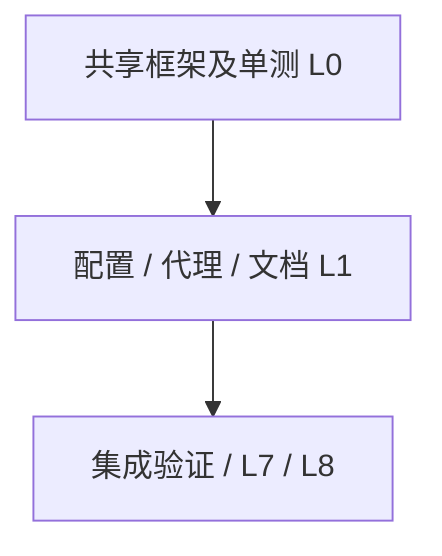

# Exec Plan

## 1. 任务映射

单人串行推进，各任务单独追踪；测试跟随实现，不拆测试 agent。

| tasks.md 条目 | 执行单元 ID | 层 |
|---|---|---|
| 1.1 | E1 | L0 |
| 1.2 | E1 | L0 |
| 2.1 | E1 | L1 |
| 2.2 | E1 | L1 |
| 3.1 | E1 | L0 |
| 3.2 | E1 | L1 |
| 3.3 | E1 | L1 |
| 3.4 | E1 | L7 |
| 4.1 | E1 | L8 |

### 未映射条目

无。

### L7 测试基线

main，HEAD 4bda9e4；全量按 openspec/project.json commands，使用 JDK 21，先 spotlessApply，再 check。保留开工前稳定的无关 docs 配置、sys_task、迁移和部署说明改动，不 stash，不清空它们。

## 2. 依赖图

## 3. 分层执行计划

- Layer 0：framework/web 的 IP 字面量、CIDR、代理策略、过滤器与解析器；framework/autoconfigure 注册及冲突检查；相关单测。先完成定向 check，再冻结契约。
- Layer 1：app application.yml、.env.example、app 集成测试及短信消费者回归；manage/nginx.conf；后端部署/契约文档、docs/deployment.md、environment.md、contracts.md。
- Layer 7/8：全量命令与 docs 构建，Nginx 运行时验证，现状追踪与验收。

## 4. 契约冻结

| 契约 | 签名 / 结构 | 定义位置 | 消费方 | 冻结 |
|---|---|---|---|---|
| C1 IP 入口 | static String resolve(HttpServletRequest) | framework/web/ClientIpResolver | E1 的访问/登录/操作日志与短信上下文读取规范 IP 字符串 | ☑ |
| C2 可信配置 | weiran.web.trusted-proxies / WEIRAN_TRUSTED_PROXIES，默认空 | framework/web 配置和 app application.yml | E1 的部署配置写逗号分隔 IP/CIDR；策略读不可变范围列表 | ☑ |
| C3 转发边界 | none + 无 ForwardedHeaderFilter；XFF 4096/32，右向左，重复/非法回退 | framework Web 策略 | E1 的 Nginx 和集成测试依据该行为 | ☑ |

契约变更记录：无。

## 5. 并行判据与文件所有权

| ID | 结论 | 原因 |
|---|---|---|
| WT-0 | 单工作区串行 | 只有本 change 活跃；已知旧改动保持不动，没有新并发信号 |
| WT-1 | 文档随代码串行 | 无需并行 |
| WT-2 | 框架必须串行 | 本次命中 framework，Layer 0 先完成 |
| WT-3 | 不另起小改动 | 不拆执行者 |

| 执行单元 | 拥有（可写） | 只读 | 禁止触碰 |
|---|---|---|---|
| E1 | 上述 framework、app 配置与测试、system 消费者测试、nginx、部署/契约/docs 文档、本 change 和 artifact.md#03 | 业务实现、构建规则、主 specs | 既有迁移、domain/api、新路由/菜单、无关 sys_task、docs Mermaid 配置、校验器与规则 |

## 6. 测试归属

E1 自测 IP 策略/过滤器/配置冲突、真实 HTTP 审计与短信限流、Nginx 边界清洗、环境模板和 docs 构建。全量门禁最后运行，避免后续源码变动使证据过期。

## 7. 失败与降级

实现失败先修复定向测试；同一全量门禁修复后再次失败按 skill 暂停并报告证据。无并行降级动作。若必须修改设计语义，停止实现并重走 L3。代理配置异常可将可信列表置空安全降级，禁止全来源信任。

## 8. 收尾要求

E1 在 exec/notes/E1-client-ip.md 记录实际修改、验证、必要连带与未覆盖项。L9 前展示本次 diff，已有无关改动单列。

## Gate

- [x] 每条 task 已映射
- [x] 共享层命中全部放 Layer 0
- [x] 无数据库结构变更，CP-7 不涉及
- [x] 依赖图无环
- [x] 待冻结契约已列出
- [x] 无独立测试执行单元
- [x] 单执行单元无同层文件相交
- [x] 禁止触碰范围已写明
- [x] 失败与降级策略已填
- [x] 本文件未回写需求、设计或 specs
