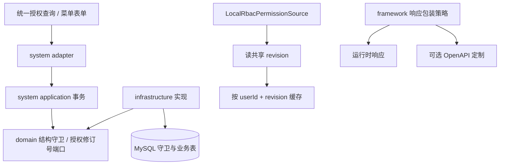

# Design

## Context

需求来自 interview.md；实现证据及调用点见 explore.md。本次覆盖 admin-foundation 的 FR-001/003/005/006/018/022/023，对应 sys_menu.md#06、artifact.md#02/#26/#04。

设计目标是补齐当前底座的并发和契约边界，复用 MySQL、Caffeine、TanStack Query 和现有冲突恢复，不增加 Redis、消息总线或另一个认证体系。当前基线 cc18cd1；用户于 2026-11-14 明确批准本设计。

## 宪法对照

| 条款 | 判定 | 说明 |
|---|---|---|
| CP-1 | ☑ 符合 | 结构守卫与授权修订号端口为纯 Java，领域层不引入框架 |
| CP-2 | ☑ 符合 | 端口在 domain、事务编排在 application、SQL 在 infrastructure |
| CP-3 | ☑ 符合 | Mapper、DO 与 SQL 锁细节不跨 infrastructure |
| CP-4 | ☑ 符合 | 文档支持依赖使用现有 BOM 的 springdoc 版本，无模块内版本号 |
| CP-5 | ☑ 符合 | 不调整质量规则，沿用 build-logic |
| CP-6 | ☑ 符合 | 不全局豁免，必要第三方泛型适配仅就地说明 |
| CP-7 | ☑ 符合 | 两个守卫表及菜单版本只通过追加 Flyway，旧脚本不改 |
| CP-8 | ☑ 符合 | 授权 revision、菜单 edit_version 与 token_version 独立；每次吊销查库保留 |
| CP-9 | ☑ 符合 | 日志不输出凭据、完整权限/身份快照 |
| CP-10 | ☑ 符合 | 保留认证错误码和账号枚举防护，不改密码入口 |
| CP-11 | ☑ 符合 | 沿用 100007/409、100004/409、100006/503，Controller 不转状态 |
| CP-12 | ☑ 符合 | framework 不依赖 system；app 只装配和验证 |
| CP-13 | ☑ 符合 | region 等业务不接触新增 sys_* 表，继续只经 system-api 使用基座 |
| CP-14 | ☑ 符合 | 不增加错误号段，复用已有通用码 |
| CP-15 | ☑ 符合 | 新迁移和 sys_* 表归属 system，不新增菜单 ID 或权限码 |

## Architecture

依赖仍为 adapter → application → domain、infrastructure → domain；图中调用经端口反转，application 不直接依赖 infrastructure。

## Data Flow

### 菜单写入

1. 菜单新增、修改、移动、改类型和删除共用同一事务级结构守卫；取得守卫是该用例事务的第一项数据库操作。守卫覆盖普通菜单编辑，先保持一致性规则简单可审计。
2. 守卫以数据库单行排他锁实现，事务提交/回滚自动释放；取得后再读取节点、父节点和完整层级并执行 Hierarchy / Menu.validate，不使用加锁前读取的数据。只用进程 synchronized 无法覆盖多实例，禁止作为替代。
3. 更新先比较草稿 version，再原子推进 edit_version；旧版本返回 409/100007，结构非法返回原 409/100004 或参数错误，不产生部分字段和授权关联变更。
4. 删除父节点与新增子节点经过相同守卫；互挂 A/B、转按钮与新增子节点竞争在最新提交状态下重新校验。首个事务成功后，后继事务必须看到它的结构。
5. 同一事务推进授权 revision 后提交。锁顺序固定为菜单结构守卫 → 业务记录 → 授权修订号；禁止反向取得结构守卫。数据库等待/超时/死锁转换为已有 503/100006，不自动重放写请求。锁等待采用有界策略（目标不超过 3 秒），事务内无外部调用。

### 后端授权

1. 新增全局授权修订号，单行 BIGINT 非负递增。用户相关身份缓存失效、角色修改/状态/菜单授权/删除、菜单新增/修改/删除等现有缓存失效入口，统一在业务事务内推进 revision；与业务一起回滚。创建用户/角色若未影响已有快照，可不推进，但对应当前会话写成功仍刷新前端。
2. LocalRbacPermissionSource 的每次 load 在新只读事务内先读取数据库 revision；缓存键是 `(userId, revision)`。缓存 TTL 和容量继续有界，旧 revision 结果不会覆盖新 revision 的键。
3. 缓存未命中时，在同一 MySQL 一致性读视图加载用户、角色和菜单，避免“新 revision 配旧权限”。缓存命中也不能省去本次 revision 读取。读版本失败时拒绝继续按旧权限放行。
4. 已开始的请求允许完成其开始时的鉴权；新请求在授权写提交后从共享库取得新 revision。全局 revision 对后台低频授权写可接受；不增加每请求全量权限查询，也不做本轮性能优化。
5. 修订号不承担吊销功能；LocalIdentityResolver 的账号状态与 token_version 每次查库不变。其它自定义 PermissionSource 保留自己的语义，不能被本地 RBAC 版本机制替换。

### 前端授权快照

1. 新增单次只读授权快照接口。用户资料、权限、可见菜单和 revision 在同一数据库视图生成；复用授权解析与菜单装配规则，避免简单拼接两个独立 HTTP 结果。旧接口保留兼容。
2. 前端以一个会话隔离的 query 为身份/菜单的唯一来源；useMe / useMyMenus 从同一 query 选择数据。统一迁移所有 me/menus 的失效、refetch 与测试，保留调用方需要的读取和错误状态。无论几处订阅，同一会话只发一个快照请求。
3. 在登录后的可见且在线页面每 30 秒校准一次；恢复前台、恢复联网立即校准。计时/事件订阅只有一处，卸载和换会话释放。使用取消信号及会话 query key，忽略旧请求/旧会话结果；每会话校准串行或去重，不能让较旧响应覆盖新快照。
4. 快照请求有 15 秒超时，不挂起后续恢复；30 秒定义为发起周期，不承诺故障网络下的 UI 完成时间。后台标签不持续轮询，回到前台立即读取。
5. 已有快照刷新失败时保留导航、按钮和当前页面，显示持续“权限信息刷新失败”及手动重试；初次失败走已有身份加载/失败恢复入口，不能显示为成功空菜单。服务端依然独立鉴权。
6. 收到 HTTP 403/100102 时，请求层仅发布当前会话的权限拒绝事件，统一校准器合并请求、设置短冷却（5 秒）；不在 request 内导入 QueryClient，避免循环依赖。校准请求自身不触发该事件；100103 不触发；无论是否静默均保留原错误。401 沿用清会话。
7. 原写请求绝不自动重放；成功后导航与按钮一次替换。路由被移除时沿用现有无权访问/路由回退逻辑；单纯按钮权限变化不重建表单、不清草稿。直接撤销当前路由时不承诺保存已卸载业务页面的草稿。

### OpenAPI

1. 提取 framework 的包装适用性判定，与 ApiResponseBodyAdvice 共用：Controller 包范围、方法/类及组合 SkipApiResponse、显式 ApiResponse / ErrorResponse 边界保持当前运行行为。不要仅按 URL 名称假定所有对象都需要包装。
2. 为目标 handler 的成功 JSON schema 自动增加单层 code/message/data；code 为 integer 且成功值为 0；data 沿用已解析的业务 schema（含 $ref、集合、泛型分页、字符串及可空数据）。显式 ApiResponse 只约束自身成功形状，不再次套 data。
3. 非目标 Controller、SkipApiResponse、无响应体状态和文件/流响应不做臆测性包装；按运行时适用规则保留原 schema，必要时通过现有 Skip 注解声明边界。保留已有响应头、媒体类型和显式接口注解，不修改共享业务 component schema 造成其它接口连带包装。
4. 为使用全局异常处理的目标接口补齐适用错误响应 schema：400/401/403/409/500/503 采用 ErrorResponse，含 code/message/data:null/requestId；已有明确的自定义响应描述优先，不把业务 code 与 HTTP 状态机械绑定。成功体没有 requestId，失败请求号与响应头一致。
5. 文档适配位于 framework 的外层独立自动配置，使用可选编译期 springdoc common 依赖和条件装配；运行时由 app 的既有 starter 提供，不向 domain/api 传递。没有 springdoc 的应用仍能启动。Swagger 和文档地址的部署开关保持仅 local 默认启用。
6. 不手写另一份接口清单，不在本轮替换全部 TS API；用真实 /v3/api-docs 与实际 HTTP 响应对照，覆盖未来生成客户端所依赖的结构。

## 跨模块契约变更(DS-1)

| 对象 | 动作 | 消费方 |
|---|---|---|
| framework 包装适用性策略 | 外层复用判定及可选文档适配；成功/失败运行时 shape 保持 | advice、springdoc |
| MenuStructureGuard / AuthorizationRevision | 纯 Java 端口；前者事务级取得，后者读取及原子推进共享版本 | application、infrastructure |
| MenuNode / 菜单编辑命令 | version 输出及更新必填校验，独立于 parentId 和 revision | system 五层、TS、docs |
| AuthorizationSnapshotView / AuthService | 增加快照读取，字段 user、menus、revision（十进制字符串，避免 JS BIGINT 精度损失） | adapter、前端 |
| auth query / 请求事件 | 一个快照 key、统一 invalidate 入口、会话隔离权限拒绝事件 | 页面、布局、权限组件 |

## API Design(DS-2)

| 路由 | 方法 | 所属模块 | 请求关键字段 | 返回关键字段 | 权限点 |
|---|---|---|---|---|---|
| /api-backend/system/menu/update/{id} | PUT | system | 现有字段 + 必填 version | 无业务数据 | system:menu:update，保留 @OperationLog |
| /api-backend/system/menu/list、get/{id} | GET | system | 现有参数 | 现有 MenuNode + version | system:menu:list |
| /api-backend/system/auth/getAuthorizationSnapshot | GET | system | 无 | user / menus / revision | 有效登录用户，无额外权限码；不记操作审计 |
| /api-backend/system/auth/getCurrentUser、listCurrentMenus | GET | system | 原参数 | 保持原结构，菜单节点增加 version | 原有效登录要求 |
| /v3/api-docs | GET | springdoc | 既有 | 自动响应 schema | 保持既有 local 开关 |

成功业务码数字 0；响应包络不变。菜单创建不要求草稿版本，编辑缺失/非法版本为 400/100001，冲突 409/100007，结构冲突 409/100004，边界存储失败 503/100006。HTTP 具体字段以 Controller/DTO 生成文档为准。

## Database Design(DS-3)

| 表 | 动作 | 关键字段 | 索引 | 备注 |
|---|---|---|---|---|
| sys_menu | 加列 | edit_version INT NOT NULL DEFAULT 0 | 保持原索引 | API 为 version，禁止溢出 |
| sys_menu_structure_guard | 新增 | id 固定 1 | 主键 | 仅作事务排他锁，缺行报错 |
| sys_authorization_revision | 新增 | id 固定 1、revision BIGINT NOT NULL DEFAULT 0 | 主键 | revision 原子递增，溢出拒绝变更 |

追加 system infrastructure 的 `db/migration/system/V202611142100__system_menu_and_authorization_boundaries.sql`。无新菜单 ID、权限码或外键；不修改历史迁移。新增表按八段模板登记 state 及索引。锁行在迁移中初始化；缺行不得静默降级为无锁或 revision=0。

## 权限与已知缺口(DS-4)

| 项 | 设计 |
|---|---|
| 权限码 | 保留菜单与角色原有权限校验；读本人快照仅需有效登录 |
| 菜单挂载 | 无新增路由或 sys_menu 种子行；动态路由规则保持 |
| 审计 | 菜单写入沿用 @OperationLog，冲突不记成成功；快照读取不追加操作日志 |
| 本轮关闭目标 | sys_menu.md#06、artifact.md#02/#26/#04，完成测试后再迁入 changelog |
| 保留缺口 | artifact.md#25 短信/MFA 共享状态、#13 非菜单资源幂等与并发、#14 日志搜索仍独立存在 |

## 分层与装配(DS-5)

| 项 | 设计 |
|---|---|
| domain/api | 纯端口与视图，无 Spring/MyBatis 类型 |
| application | 事务顺序、revision 缓存边界、单次快照编排 |
| infrastructure | MySQL 排他锁及修订号查询/更新、MenuDO/version 映射 |
| adapter | DTO 必填约束、快照路由、已有权限和日志注解 |
| 自动装配 | system 既有自动配置登记端口实现；framework 文档配置独立条件装配，无 ComponentScan |
| 构建依赖 | framework 的 springdoc 为可选 compileOnly，版本从现有 BOM 取；测试可用 testImplementation，不改成 api |
| app | 只测试及装配，不承载业务实现 |

## 前端设计(DS-6)

| 项 | 内容 |
|---|---|
| 页面/路由 | 现有 MenuFormModal / 布局与权限上下文，不新增业务页面 |
| 草稿保护 | 菜单复用 useEditConflict、EditConflictFeedback、useFormCloseGuard；冻结初始字段+version，确认重载树选项与记录成功才一起替换 |
| 授权数据 | 一个 session key 的 query；useMe/useMyMenus 同源选择；所有身份/菜单失效迁入统一入口 |
| 刷新反馈 | 一处生命周期协调，持续错误与重试；加载不清上次快照，成功空菜单可展示明确无可访问菜单 |
| docs | PageStateDemo 中增加菜单冲突及授权校准场景；复用实际 hook/反馈/权限呈现，模拟正常、加载、空、失败重试、禁用及权限撤销/恢复 |
| 本地演示数据 | 使用模拟读取/写入适配，不使用真实 Cookie、账号或后端；沿用 ClientOnly 与 Vue/React 挂载 |

## Observability

- 锁和 revision 故障使用已有 requestId、错误定义及全局日志；不输出凭据、完整权限列表或身份信息。
- 可观察菜单结构锁等待/失败、授权 revision 读取失败、前端最近成功校准时间和持续失败态。
- 日常校准不逐次记录 INFO；不增加全局遥测系统。排障入口为请求号、后端错误日志和页面重试反馈。

## Test Plan

| 层级 | 场景及判据 | 对应 AC |
|---|---|---|
| MySQL 并发事务 | 两个独立连接互挂 A/B、父删子增、转按钮与子增；锁超时/回滚，无环无孤儿，不能只跑串行失败例子 | AC-1 |
| 菜单 HTTP + 前端 | version 必填/冲突/成功递增；旧草稿保留、取消重载和读取失败，成功重载同时替换树与版本 | AC-2 |
| 双缓存共享数据库 | 两个 LocalRbacPermissionSource 独立缓存，真实应用服务逐类更改授权；提交后 B 新鉴权更新，回滚保持；版本读取失败拒绝 | AC-3 |
| 交错加载 | revision 读取与加载穿插写事务，快照绑定一致视图；旧响应不能覆盖新版本 | AC-3/4 |
| 前端假时钟与事件 | 30 秒、隐藏/前台、离线/上线、请求超时、成功/失败/空、401/403/100103、会话切换及去重 | AC-4/5 |
| 写请求次数 | 并发 403 只触发合并校准，不重放写请求，无校准递归 | AC-5 |
| 真实 OpenAPI HTTP | 测试上下文显式开启 api-docs，对照对象、列表、分页、String、显式 ApiResponse<Void>、跳过包装及组合注解、失败体；解析 $ref 并断言实际 JSON | AC-6 |
| 无 springdoc 类路径 | framework 条件配置不加载文档类型，原 HTTP 行为正常 | AC-6 |
| docs 浏览器 | 实际组件交互，权限/导航同步、冲突及失败恢复，正常/窄屏明暗主题，无业务网络请求 | AC-7 |
| 全量门禁 | 先 JDK21 spotlessApply，再逐条运行 openspec/project.json commands；docs 构建和 openspec:check | AC-7 |

实现后按 schema 记录真实 L7 证据，不在设计阶段声称测试已通过。

## Rollout Plan

1. 维护窗口备份数据库，停止旧实例写入；Flyway 执行新增表/列迁移。
2. 同步切换所有后端实例和前端，要求刷新旧标签。旧前端菜单编辑缺 version 会报参数错误，不能允许无版本降级覆盖。
3. 验证菜单守卫与 revision 行存在，两个实例改权/撤权和旧草稿冲突；验证 local 文档与实际成功/失败响应一致。
4. 后端鉴权边界不依赖浏览器校准成功；确认 docs 演示可独立运行。旧接口保留兼容，但外部直接 SQL 改授权必须显式推进 revision，禁止旁路写入假设自动失效。

## Rollback Plan

1. revert 锚点：本 change 实现提交的父提交；当前规划基线 `cc18cd1`。撤回实现前限制菜单和授权写入口，避免旧实例绕过新保护。
2. Flyway 已发布脚本与新增表/列保留，不删迁移、不重置 revision 或 token_version；优先前滚修复。
3. 前后端同步回退，不以仅回退前端绕过版本要求；退回旧实现将恢复旧缓存及菜单并发风险，须在发布记录明确该边界。

## Open Questions

- 无。设计已获 L3 批准，按冻结契约推进实现。
