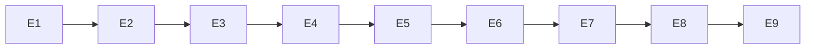

# Exec Plan

## 1. 任务映射
| tasks.md 条目 | 执行单元 ID | 层 |
|---|---|---|
| 1.1 文档包装策略 | E1 | L0 |
| 2.1 共享端口及类型 | E2 | L0 |
| 3.1 菜单结构/版本 | E3 | L0 |
| 3.2 授权缓存/快照 | E4 | L2 |
| 4.1 HTTP 入口 | E5 | L3 |
| 5.1 菜单草稿恢复 | E6 | L4 |
| 5.2 统一授权校准 | E7 | L5 |
| 5.3 文档演示 | E8 | L6 |
| 6.1 文档及全量验证 | E9 | L7 |

### 未映射条目
无。
### L7 测试基线
基线 main/cc18cd1；完整执行 openspec/project.json commands，不缩减全量验证。

## 2. 依赖图

全程单 agent 串行，类型、数据与调用契约依赖均先完成再消费。

## 3. 分层执行计划
### Layer 0
E1 文档策略及测试、E2 纯契约、E3 一次性全部迁移，按此顺序串行；framework 与领域契约冻结后继续。
### 后续层
E4~E9 顺序执行，各自测试和收尾；共享 TS 类型由 E2 冻结，各消费者补齐 fixture 属于必要连带。

## 4. 契约冻结
| 契约 | 签名 / 结构 | 定义位置 | 消费方 | 冻结 |
|---|---|---|---|---|
| 结构守卫 | void acquire()，当前事务持有 | domain/menu | E3 菜单先锁再读；E5 复用服务 | ☑ |
| 授权修订号 | long current(); void advance() | domain/auth | E4 每次读 revision，写失效与业务事务提交 | ☑ |
| 菜单版本 | int version，更新必填 | domain/api、DTO、TS | E3/E5 比较递增；E6 冻结草稿版本 | ☑ |
| 授权快照 | user、menus、revision 字符串 | system-api/TS | E4 同一视图生成；E7/E8 同批替换 | ☑ |
| 响应包装 | 现有单层成功体，错误体含 requestId | framework 外层 | E1 schema 与运行时共用判定，E5 保持响应 | ☑ |
### 契约变更记录
无。

## 5. 并行判据与文件所有权
单 agent 串行，无 worktree、无子代理，不与他人同时推进。
| ID | 判定 |
|---|---|
| WT-0 | 只有本 change 改动，可推进 |
| WT-1 | 文档随本 change 串行完成 |
| WT-2 | framework 改动独占本工作区 |
| WT-3 | 不以改动小为由并发 |

| 执行单元 | 拥有(可写) | 只读 | 禁止触碰 |
|---|---|---|---|
| E1 | framework 源码/构建与测试、app OpenAPI 测试 | 已批准 design/spec | 历史迁移、归档、region、短信/MFA 及其它任务范围 |
| E2 | system-domain/api、TS 类型 | 已批准 design/spec | 历史迁移、归档、region、短信/MFA 及其它任务范围 |
| E3 | system menu/domain/application/infrastructure、Flyway、菜单并发测试 | 已批准 design/spec | 历史迁移、归档、region、短信/MFA 及其它任务范围 |
| E4 | system auth/application/infrastructure、用户角色失效入口、授权测试 | 已批准 design/spec | 历史迁移、归档、region、短信/MFA 及其它任务范围 |
| E5 | system-adapter、API/请求测试 | 已批准 design/spec | 历史迁移、归档、region、短信/MFA 及其它任务范围 |
| E6 | manage 菜单表单及测试 | 已批准 design/spec | 历史迁移、归档、region、短信/MFA 及其它任务范围 |
| E7 | manage auth queries/request/布局及受影响测试 | 已批准 design/spec | 历史迁移、归档、region、短信/MFA 及其它任务范围 |
| E8 | docs 演示、复用授权反馈与本地适配 | 已批准 design/spec | 历史迁移、归档、region、短信/MFA 及其它任务范围 |
| E9 | state、架构、部署、组件登记、exec evidence | 已批准 design/spec | 历史迁移、归档、region、短信/MFA 及其它任务范围 |

## 6. 测试归属
测试跟随实现；E1 真实 schema/HTTP 与无依赖装配，E3 并发结构/版本，E4 双缓存和提交回滚故障，E5 HTTP/DTO，E6 表单冲突，E7 校准时序和请求次数，E8 浏览器演示。E9 汇总全量门禁，非独立测试单元。

## 7. 失败与降级
编译/测试失败定点修复；同一门禁重试仍失败按 workflow 归因。无并发降级需求。设计问题回 L2 并重新审批，不静默缩减。全部源代码完成后才生成 L7 证据，之后不 stash。

## 8. 收尾要求
每个单元将实际改动、测试和必要连带写入 exec/notes/E<N>-implementation.md。最后 verify 回指 AC 与需求；最终 diff 需 L9 确认才归档。

## Gate
- [x] 每条 task 都已映射，未映射无
- [x] 共享层命中全部进入 Layer 0
- [x] 数据库仅追加 Flyway，符合 CP-7
- [x] 依赖图无环，包含前后端契约依赖
- [x] Layer 0 契约冻结表已列出
- [x] 无独立测试执行单元
- [x] 同层无并行，文件归属明确
- [x] 每个执行单元禁止触碰已写明
- [x] 失败与降级策略已填写
- [x] 未回写 tasks/design/spec 的意图内容
