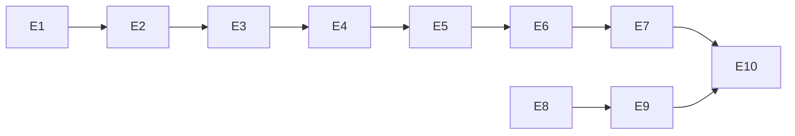

# Exec Plan

## 1. 任务映射
| tasks.md 条目 | 执行单元 ID | 层 |
|---|---|---|
| 1.1 | E1 | L0 |
| 2.1 | E2 | L0 |
| 3.1 | E3 | L0 |
| 3.2 | E4 | L1 |
| 4.1 | E5 | L2 |
| 5.1 | E6 | L3 |
| 5.2 | E7 | L4 |
| 6.1 | E8 | L0 |
| 6.2 | E9 | L1 |
| 7.1 | E10 | L5 |

### 未映射条目
无。

### L7 测试基线
基线 e10c7ac；按 project.json commands 跑全量门禁。既存 config.mts、sys_task、批处理兼容迁移及部署文档原有改动保留，必要修改按增量记录。

## 2. 依赖图

单人串行执行，图表示类型、数据、调用及契约依赖；E8/E9 也串行，不委派代理。

## 3. 分层执行计划
### Layer 0
E1 错误定义；E2 版本与准入纯 Java 契约；E3 追加两份迁移、配置、共享短事务实现及其测试；E8 config/schema/templates 的当前事实。所有共享资源串行完成。
### Layer 1 及后续
E4 用户/角色事务与 repository 条件写；E5 Controller 校验及入口集成；E6 TS/hooks/表单与安全入口反馈；E7 docs 演示；E9 守卫及真实 CLI 验证；E10 部署/状态文档与债务更新。测试随各实现单元。

## 4. 契约冻结
| 契约 | 签名 / 结构 | 定义位置 | 消费方(逐单元列出所读/所写的键) | 冻结 |
|---|---|---|---|---|
| 编辑冲突 | 100007 / 409 | CommonErrors | E4 抛出，E5 全局输出，E6 判定保留草稿 | ☑ |
| 尝试拒绝 | 110108 / 429；100006 / 503 | SystemAuthErrors / CommonErrors | E3 判定，E5 输出，E6 不清会话不重放 | ☑ |
| 编辑版本 | int version 非负、更新必填，数据库 edit_version | system-api/domain | E4 CAS +1；E5 @NotNull/@Min；E6 冻结字段和 version | ☑ |
| 准入 | 原子预占多个 scope/key 桶，窗口/限额/硬容量 | domain port | E3 实现，E5 调用共享密码路径，拒绝不 BCrypt | ☑ |
| 提示词 | 现行 Java/MySQL/Flyway/数字0/动态菜单 | schema/config/templates | E8 修订；E9 检查组合 CLI 输出且保留历史否定说明 | ☑ |

### 契约变更记录
无。

## 5. 并行判据与文件所有权
无并行，无 worktree；遵守 WT-0～WT-3，框架、迁移与流水线串行。所有单元由当前 Codex 执行，不允许他人并发构建或 clean。
| 执行单元 | 拥有(可写) | 只读 | 禁止触碰 |
|---|---|---|---|
| E1 | framework 错误 | rules | 已发布迁移 |
| E2 | system api/domain 契约 | framework | 其他业务模块 |
| E3 | 新迁移、system infrastructure、app 配置及准入测试 | domain | 历史迁移 |
| E4 | system application/infrastructure、编辑测试 | 契约 | 其他业务 |
| E5 | system adapter、HTTP 测试、密码应用接入 | 契约 | 菜单种子 |
| E6 | manage types/hooks/components/pages 与测试 | 后端契约 | 后端 |
| E7 | docs 示例与组件登记 | 实际组件 | 生产接口数据 |
| E8 | config/schema/templates | rules | 历史归档 |
| E9 | guards/project.json/check.mjs/tests、check.md/CHANGELOG | schema | 规则含义 |
| E10 | 部署说明、state/bizs、designREADME | 实际实现 | 其他既存 diff |

## 6. 测试归属
E3 数据库双适配器并发/容量/故障；E4 用户/角色 CAS 与关系回滚；E5 HTTP 缺版本与认证错误；E6 编辑状态与认证反馈；E7 真浏览器；E9 正反夹具与真实 CLI。全量命令的最终证据在全部代码完成后生成。

## 7. 失败与降级
构建失败定位后重试一次，同一检查仍失败报告；不自动降低规则。契约变更先暂停消费方；设计意图变化需重新 L3，细节修订记录笔记。不启用子代理或并行降级流程。

## 8. 收尾要求
各单元完成记录 exec/notes/E*-*.md，申报必要连带改动、验证与未覆盖项。

## Gate
- [x] 每条 task 都已映射
- [x] 共享层命中项全部落在 Layer 0
- [x] 数据库只追加 Flyway；无 PHP 共库，按 CP-7 审核
- [x] 依赖图无环且隐性契约依赖明确
- [x] 契约冻结表已列出
- [x] 测试跟随实现
- [x] 串行执行，不存在同层文件同时写
- [x] 各单元禁止触碰已明确
- [x] 失败与降级策略已填
- [x] 无执行细节回写上游
