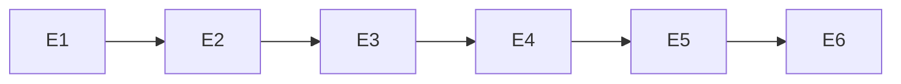

# Exec Plan

## 1. 任务映射

| tasks.md 条目 | 执行单元 ID | 层 |
|---|---|---|
| 1.1 | E1 | L0 |
| 2.1 | E2 | L1 |
| 2.2 | E3 | L1 |
| 2.3 | E4 | L1 |
| 2.4 | E5 | L1 |
| 3.1 | E6 | L2 |

### 未映射条目

无。基线 26ca3c9，实施只有本change规划文件未跟踪；无并行change。

## 2. 依赖图

均为调用/契约依赖；所有工作串行，禁止子代理或worktree。

## 3. 分层执行计划

- Layer0 E1：测试共享 API会话、响应断言、写前提、资源类型映射/私有登记/精确恢复及对应负例。先冻结消费者签名。
- Layer1 E2：读取/匿名/地区；E3：用户/角色/菜单；E4：字典/配置；E5：权限生命周期。每单元自带步骤回归/合成模型。
- Layer2 E6：注册/发现、根脚本、合成CLI、旧样本选择、docs/现状与整体联调。

## 4. 契约冻结

| 契约 | 签名/结构 | 位置 | 消费方 | 冻结 |
|---|---|---|---|---|
| 响应 | requireValue、ok/error、page/tree；失败固定消息，不输出payload | tests/support/api/protocol.mjs | E2～E5 读取 | ☑ 依设计冻结 |
| API身份 | withApiSession(options, operation)，独立jar/远端主体，清理或保留私有恢复 | tests/support/api/session.mjs | E2～E6调用；可选借用已验证缓存 | ☑ 依设计冻结 |
| 所有权 | ResourceLedger(scope)、create/cleanup/recover；记录type/key/id/parent/intent，私有0600 | tests/support/api/resources.mjs | E3～E6写/清理/恢复 | ☑ 依设计冻结 |
| 前提 | writes=true 时 FLOW_ALLOW_WRITE === true字符串；首次登录前拒绝 | tests/support/api/session.mjs | E3～E6 | ☑ 依设计冻结 |
| 证据 | before/after/cleanup白名单状态；读流程契约摘要与会话清理 | steps/spec | 所有流程与strict复核 | ☑ 依设计冻结 |

具体类型实现以共享模块导出为准；行为保持上述批准意图。共享行为改变先暂停消费者、记录原因，不改产品契约。

## 5. 文件所有权与工作区

| 单元 | 拥有 | 只读 | 禁止 |
|---|---|---|---|
| E1 | tests/support/api、tests/support/fixtures/api.ts、tests/unit/api-tools.test.mjs | framework/session、Controller/DTO | packages生产/Java测试、源项目、历史归档 |
| E2 | steps/api/read.ts、api/system/core-read、api/region/read、system/access-boundary步骤、tests/unit/api-read.test.mjs | E1、读取Controller | 同上 |
| E3 | steps/api/identity.ts、api/system/{user,role,menu}-lifecycle、tests/unit/api-identity.test.mjs | E1、当前DTO/业务约束 | 同上 |
| E4 | steps/api/platform.ts、api/system/{dict,config}-lifecycle、tests/unit/api-platform.test.mjs | E1、当前DTO/业务约束 | 同上 |
| E5 | steps/api/permissions.ts、api/system/permission-boundary、tests/unit/api-permissions.test.mjs | E1与E3创建行为 | 同上 |
| E6 | registry.json、INDEX、package.json、tests/synthetic、tests/unit合成支持、旧框架回归样本选择/数量断言、tests/docs、docs/testing.md、state/bizs/artifact.md | E1～E5和全部证据 | 同上 |

E1私有目录不由开发者读取真实材料。L7从project.json读取命令，全部代码完成后JDK21先spotlessApply，再串行build/test/lint，日志保存exec/evidence。

### 并行判据

| ID | 场景 | 本次结论 | 原因 |
|---|---|---|---|
| WT-0 | 他人change | 未命中 | 开工仅本change文件 |
| WT-1 | 纯文档/规格 | 串行 | 最后同步实际实现 |
| WT-2 | framework/流水线本体 | 未命中生产 | 测试工具共享层依然串行 |
| WT-3 | 小改动 | 不并行 | 单checkout同一执行者 |

## 6. 测试归属

每单元完成自身正负例，合成服务共享样本E1先建必要协议后逐步扩展；E6最后运行实际CLI装配。无独立测试执行单元，不靠mock结果声称真实业务通过。

## 7. 失败与降级

- 缺真实服务/账号：明确未运行，继续离线/合成；不默认admin123，不启动业务服务。
- 同一门禁修复后仍失败：按技能升级汇报，不放宽strict。
- 清理不确定：保留私有材料，固定错误且执行失败；禁止批删或直连数据库。
- 发现设计不可行：停止依赖部分回设计，不悄悄删范围。
- 发现必要文件连带：执行笔记申报；越界扩大回退。

## 8. 收尾

每单元落exec/notes/E<N>-implementation.md；全部任务完成后真实L7与verify；L9用户审阅后才归档。本次不自动提交/推送。

## Gate

- [x] 每条task逐条映射
- [x] 共享命中Layer0
- [x] 无数据库迁移或序号申请
- [x] DAG无环，隐含Cookie/所有权依赖明确
- [x] Layer0契约冻结
- [x] 测试跟随实现，不拆独立测试单元
- [x] 单工作区串行，无同层文件交叉
- [x] 每单元拥有/只读/禁止明确
- [x] 失败与降级明确
- [x] 未回写设计/任务工程细节
