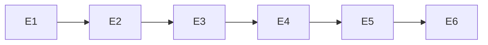

# Exec Plan

## 1. 任务映射

| tasks.md 条目 | 执行单元 ID | 层 |
|---|---|---|
| 1.1 | E1 | L0 |
| 1.2 | E2 | L0 |
| 1.3 | E3 | L0 |
| 2.1 | E4 | L1 |
| 2.2 | E5 | L2 |
| 3.1 | E6 | L3 |

### 未映射条目

无，6 条任务均逐条映射。

### L7 测试基线

- main / f8f996c；使用 openspec/project.json commands 的完整 build/test/lint，JDK21 先 spotlessApply；证据最后一次性写入 exec/evidence。

## 2. 依赖图

| 执行单元 | 前置 | 依赖性质 |
|---|---|---|
| E2 | E1 | CLI、注册表与目录契约 |
| E3 | E2 | 运行记录与清理失败契约 |
| E4 | E3 | Cookie session API、fixture 与证据 |
| E5 | E4 | 已可执行的离线脚本与系统发现 |
| E6 | E5 | 实际命令、覆盖与验证边界 |

## 3. 分层执行计划

### Layer 0 —— 串行共享层

| 执行单元 | 内容 | 涉及文件 |
|---|---|---|
| E1 | 迁入 CLI/声明/脚手架/维护与依赖、根目录骨架 | tests/framework、tests/registry.json、tests/playwright.config.ts、tests/tsconfig.json、package.json、pnpm-lock.yaml、.gitignore |
| E2 | 核对严格批次/执行/复核/取消与回归 | tests/framework/{batch,process,core,catalog,inspect,bruno}.mjs 与对应 unit/browser 测试 |
| E3 | Cookie/CSRF 会话与人工浏览器适配、私有材料保护与回归 | tests/framework/{session,browser,cli}.mjs、session/browser 回归 |

完成判据：各单元本地回归通过；共享契约表冻结后进入系统步骤。

### Layer 1 —— 串行系统流程

E4：tests/api、e2e、bruno、support、unit、envs、registry.json；建立 7 条适配流程和 fixture，合成 HTTP/Chromium 验证。缺真实服务/凭据如实记录，不自动起业务进程。

### Layer 2 —— 工程接入

E5：根 package.json 命令与 .github/workflows/ci.yml，离线 job 使用 Node24。原 Vitest 与 Gradle 门禁不变。

### Layer 3 —— 文档

E6：tests/README.md、tests/docs、framework/README.md、docs/testing.md、docs/.vitepress/config.mts、README.md、AGENTS.md、openspec/state/bizs/artifact.md；不写虚假真实通过记录。

## 4. 契约冻结

| 契约 | 签名 / 结构 | 定义位置 | 消费方(逐单元列出所读/所写的键) | 冻结 |
|---|---|---|---|---|
| 流程 | version/id/title/runner/entry/kind/envs/tags/expectedCases/params/preconditions/verification/limitations/steps/inputs/cleanup/evidence/project/businessProject | tests/framework/core.mjs | E2 读 expectedCases/evidence，E4 写 7 条完整声明，E5 发现/check | ☑ 按设计冻结 |
| 环境 | apiBaseURL=http://localhost:5200、webBaseURL=http://localhost:5202；CLI/env 可覆盖，移除 Actuator | tests/envs/local.json、framework/core.mjs | E3 绑定两地址，E4 requests 与 browser baseURL，E5 doctor | ☑ 按设计冻结 |
| 认证 | 私有 Cookie storageState + role/environment/两地址/userId/username/expiry；sessionRequest 同 jar 维护 Cookie/CSRF，数字 code | tests/framework/session.mjs | E3 写缓存与请求，E4 身份检查/授权快照/登出清理，E5 CLI session 命令 | ☑ 按设计冻结 |
| 清理 | logout 清 Cookie；匿名上下文401；本地缓存删除；不能断言旧 JWT 被吊销 | tests/framework/session.mjs | E2 严格清理证据，E3 恢复状态，E4 流程 finally | ☑ 按设计冻结 |
| 报告 | 批次/独立 runId/原始结果/附件摘要/独立复核；敏感材料不入普通产物 | tests/framework/core.mjs | E2 校验全部字段，E3 保护敏感内容，E4 附白名单状态 | ☑ 按设计冻结 |

### 契约变更记录

无。实现中的兼容适配不改已批准业务语义；必要工程调整记执行笔记。

## 5. 并行判据与文件所有权

本次单 checkout、单执行者，所有单元串行；不创建 worktree 或子代理。

| ID | 场景 | 本次结论 | 原因 |
|---|---|---|---|
| WT-0 | 他人正在推进 | 未命中 | 开工只有本 change 未跟踪规划文件。 |
| WT-1 | 纯文档/流水线 | 不并行 | 文档留到最后同步实际行为。 |
| WT-2 | Java framework/流水线本体 | 不改这些实现 | 新 tests/framework 是独立测试工具。 |
| WT-3 | 小改动 | 不适用并行 | 本次为跨测试工具迁移，按依赖串行。 |

| 执行单元 | 拥有(可写) | 只读 | 禁止触碰 |
|---|---|---|---|
| E1 | 第3节列出的框架/根文件 | 源 tests、当前应用 | 所有 packages 实现、源项目私有材料、历史归档 |
| E2 | 框架执行/证据模块及回归 | E1 CLI/注册契约 | 所有 packages、源项目、openspec 校验器 |
| E3 | session/browser/CLI 接入和对应回归 | E2 证据契约、当前认证源码 | 修改产品登录/吊销/数据、源私有配置 |
| E4 | 系统流程/support/fixture/unit/注册与合成样本 | E3 认证契约、当前页面/接口 | packages 实现与旧 test-flows、合同/返利/STS |
| E5 | package.json 测试脚本/CI | 测试目录和原有门禁 | 业务模块、降低门禁、真实 CI 凭据 |
| E6 | 第3节列出的文档/现状 | 所有实现与证据 | 业务代码、未运行结果宣称通过 |

## 6. 测试归属

| 执行单元 | 测试范围 | 测试文件 |
|---|---|---|
| E1 | CLI/脚手架/路径/维护 | tests/framework/unit/{cli,framework,inspect,utils}.test.mjs |
| E2 | 报告/摘要/附件/批次/取消 | tests/framework/unit/core.test.mjs、framework/browser/framework.integration.mjs |
| E3 | Cookie/CSRF/主体/地址/角色/缓存/恢复/隐私 | tests/framework/unit/session.test.mjs、合成浏览器会话 |
| E4 | 系统步骤、7条发现、模拟真实协议 | tests/unit、framework/browser、各流程 spec |
| E5 | 根离线命令与CI YAML | test:flows:check、YAML 解析 |
| E6 | 文档链接/构建/覆盖口径 | docs 构建、OpenSpec检查 |

## 7. 失败与降级

| 场景 | 处置 |
|---|---|
| 工具/依赖失败 | 先归因、在授权范围修复再重跑；网络/缓存访问按环境权限升级，不关闭验证。 |
| 同一检查修复后仍失败 | 汇报具体证据；不缩减范围或把失败改成跳过。 |
| 需要改业务契约 | 停止消费方，回到设计核对；不在测试里篡改产品。 |
| 真实服务或账号缺失 | 明确未运行/前提失败，继续可执行的离线与合成工作。 |
| 意外他人改动 | 不覆盖，停止冲突部分并说明。 |

## 8. 收尾要求

每单元结束写 exec/notes/E<N>-implementation.md，声明范围、测试、必要连带和遗留项；所有实现完成后最后生成 L7，再完成 L8 一致性与 L9 最终差异审阅。

## Gate

- [x] 每条 task 已映射
- [x] 共享命中落在 Layer 0
- [x] 无数据库结构变化，无 Flyway 修改
- [x] 依赖图无环，隐性认证/证据契约已识别
- [x] Layer 0 契约表已列出并冻结
- [x] 无独立测试执行单元
- [x] 全部串行，无同层文件交叉写入
- [x] 每个执行单元禁止触碰已声明
- [x] 失败与降级策略已明确
- [x] 未向 tasks/design/specs 回写工程细节
